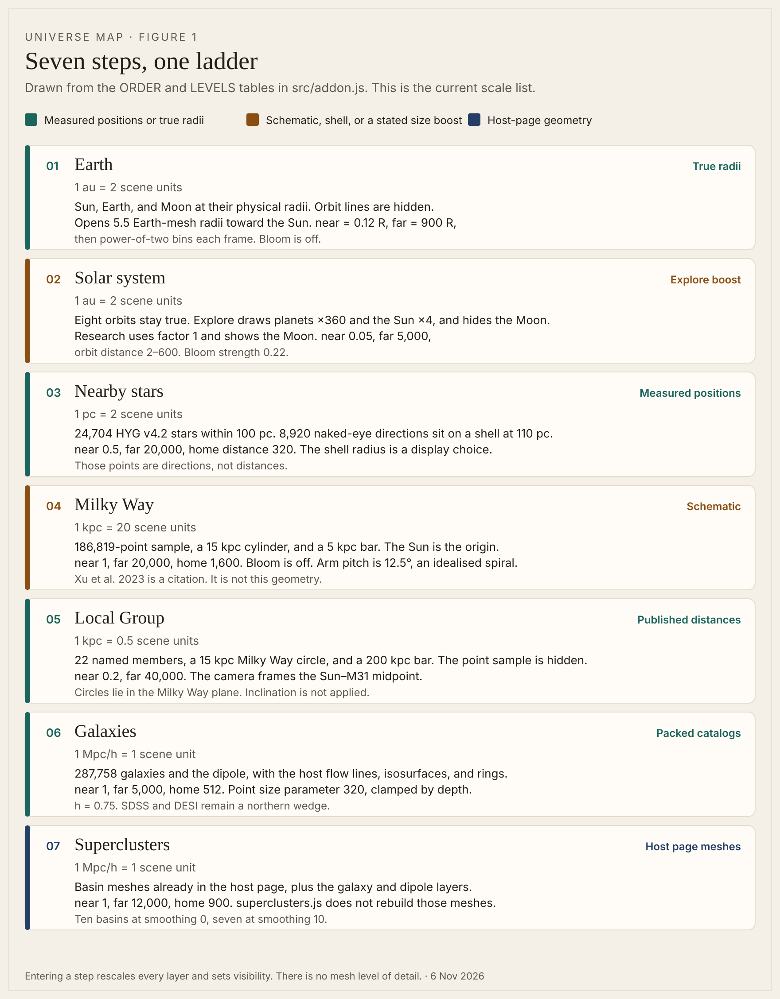
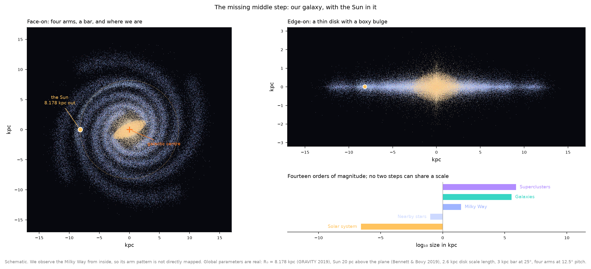
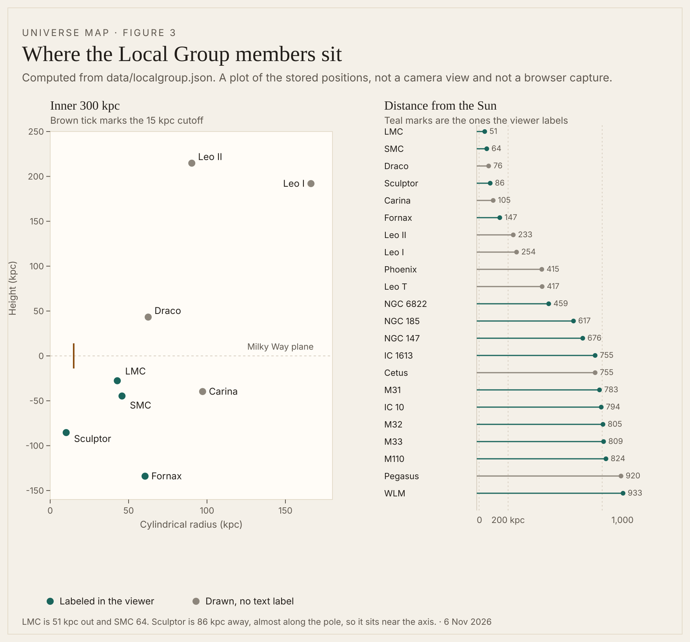
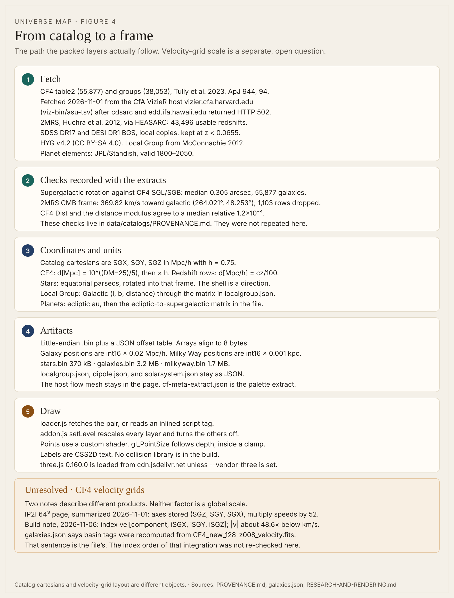
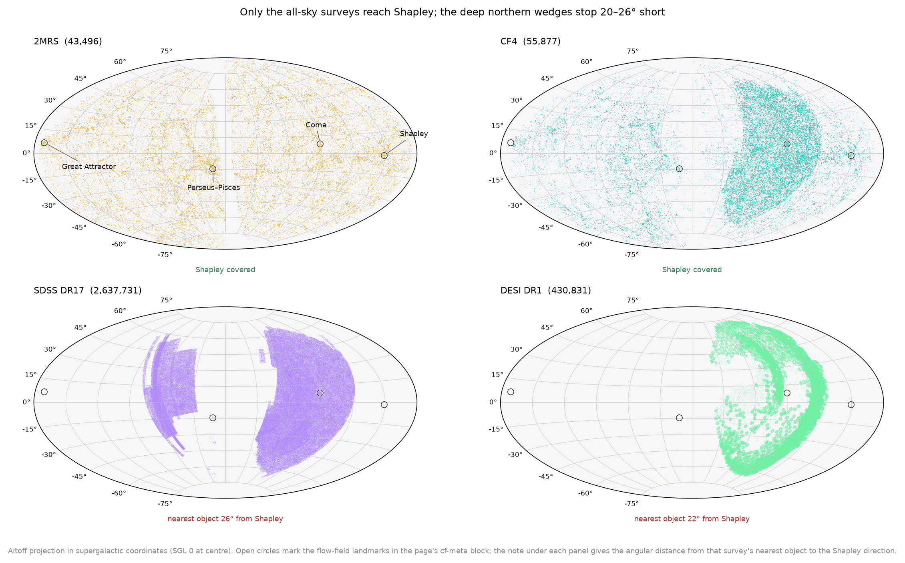
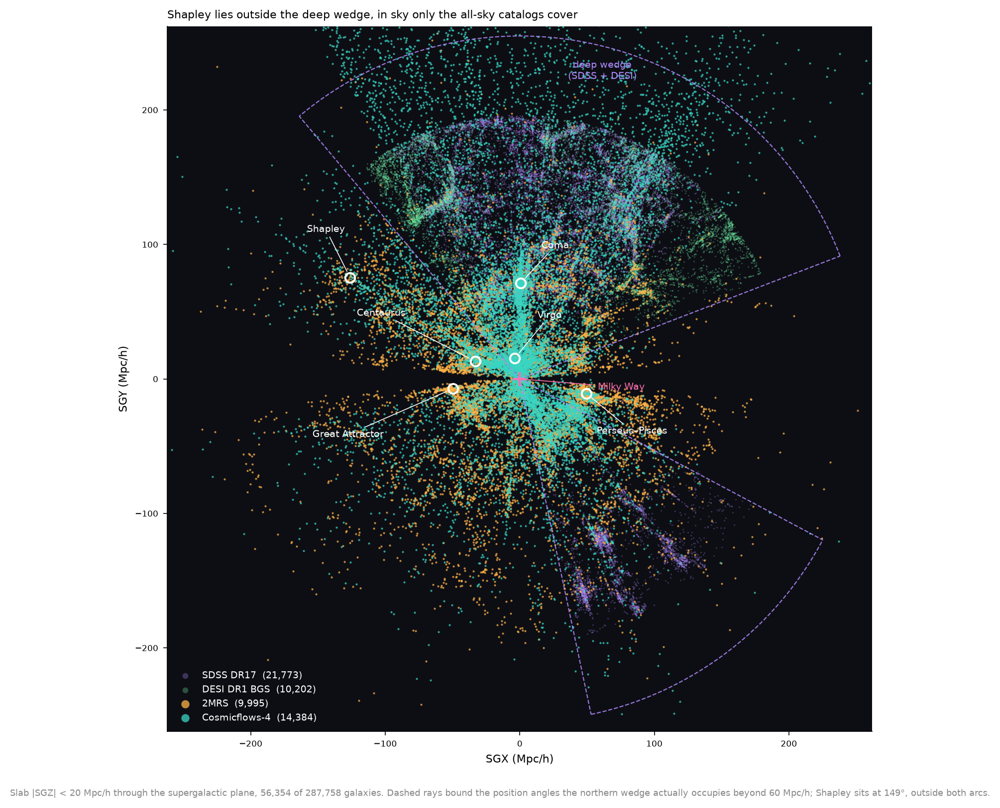
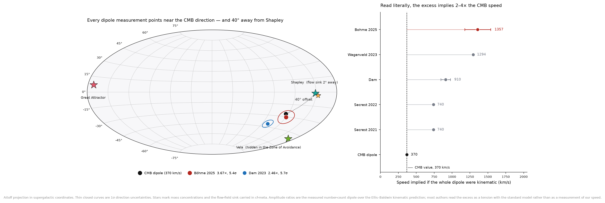
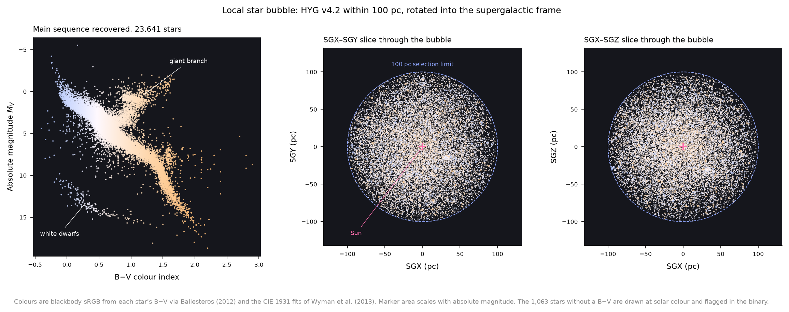
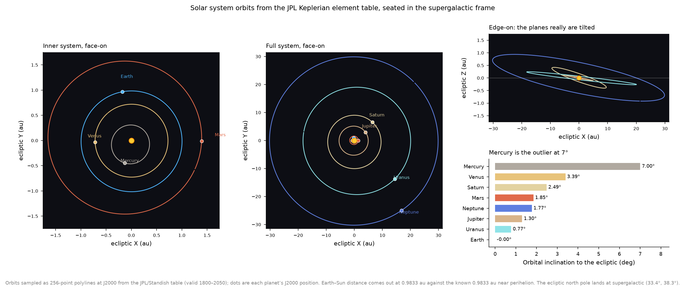
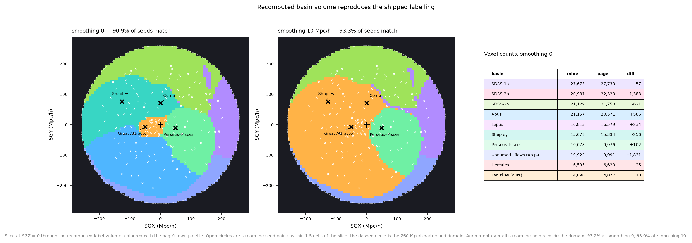

# Universe Map

Layers for the Laniakea Remapped viewer: nearby stars, a packed galaxy catalog, the number-count dipole, a schematic Milky Way, the Local Group, and the solar system. The host page keeps the Cosmicflows-4 flow field and the basin meshes. This repository holds the added layers, the catalog extracts they read, and the notes on what has been checked.

A step on the scale ladder sets both the scale and which layers are visible. The solar system and the galaxy field are never on screen together. There is no scale at which both are legible: the planetary system is about 3×10⁻¹⁰ Mpc/h across.

The modules under `src/` are the behavior described below. This note does not change them.

**Open on 6 November 2026.** Earth-surface flicker is unresolved. The Milky Way arms are the schematic in `data/milkyway.json`. Xu et al. 2023, ApJ 947, 54, is the morphology citation; it is not the geometry in the file. Chrome Research frames that day showed the LMC and SMC labels crowding the Milky Way label. One Galaxies frame without a filled pink block is not a sign-off. Safari, `tools/verify.py`, and a network-disabled load were not part of the latest pass. A module smoke test was re-run and passed. It does not draw a frame.

No website frame was captured for this note. The host HTML is not in this repository, and `tools/patch.py` is what turns that page into the viewer. The new drawings here are diagrams of the source and the data files. The PNG plots already in `figures/` are earlier catalog diagnostics.

---

## Scope

| Piece | Where it lives |
|---|---|
| Stars, galaxies, Milky Way sample | `data/*.bin` with a JSON sidecar |
| Local Group, dipole, orbits | `data/localgroup.json`, `data/dipole.json`, `data/solarsystem.json` |
| Textures | `textures/`, rights in `textures/ATTRIBUTION.md` |
| Flow lines, density surfaces, basin meshes | The host page. `src/superclusters.js` only looks them up |
| Palette extract | `data/cf-meta-extract.json` |

Bulk survey files (FITS grids, full TSVs) are not in this repository. The extracts that are here are the parquet files under `data/catalogs/` and the packed layers. No application license is stated. Texture terms and catalog terms are separate, and they are separate from each other.

---

## The scale ladder



**Figure 1.** The seven steps in `src/addon.js` (`ORDER` and `LEVELS`). Vector drawing: [`figures/scale-ladder.svg`](figures/scale-ladder.svg). Entering a step rescales every layer and sets visibility. Toggles for layers outside the step are disabled. This is a diagram of that table. It is not a capture of the page.

| Step | Scene scale | What is drawn | Camera, scene units | Bloom |
|---|---|---|---|---|
| Earth | 1 au = 2 | True radii. Orbit lines hidden | Opens 5.5 Earth-mesh radii toward the Sun. `near = 0.12 R`, `far = 900 R`, then power-of-two bins each frame. Distance 1.8 R–220 R after the flight | Off |
| Solar system | 1 au = 2 | True orbits. Explore: planets ×360, Sun ×4, Moon hidden. Research: factor 1, Moon shown | near 0.05, far 5,000, distance 2–600, home 8 | 0.22 / 0.8 |
| Nearby stars | 1 pc = 2 | 24,704 HYG positions within 100 pc. 8,920 naked-eye directions on a shell at 110 pc | near 0.5, far 20,000, distance 5–2,000, home 320 | 0.40 / 0.62 |
| Milky Way | 1 kpc = 20 | Schematic sample, 15 kpc cylinder, 5 kpc bar. Sun at the origin | near 1, far 20,000, distance 20–8,000, home 1,600 | Off |
| Local Group | 1 kpc = 0.5 | 22 named members, 15 kpc Milky Way circle, 200 kpc bar. Point sample hidden | near 0.2, far 40,000, distance 2–8,000. Frame is the Sun–M31 midpoint | Off |
| Galaxies | 1 Mpc/h = 1 | 287,758 galaxies, dipole, host flow field | near 1, far 5,000, distance 60–1,400, home 512 | 0.40 / 0.62 |
| Superclusters | 1 Mpc/h = 1 | Host basin meshes, plus galaxies and the dipole | near 1, far 12,000, distance 100–3,000, home 900 | 0.40 / 0.62 |

`h = 0.75` on the galaxy and supercluster steps. Bloom pairs are `(strength, threshold)` on the host composer. Earth, the Milky Way, and the Local Group set strength to 0.

There is no mesh level of detail. Galaxy and Milky Way points are one buffer each, with `frustumCulled` off. `gl_PointSize` follows depth inside a clamp (`galaxies.js`: 0.7–9 px; `milkyway.js`: 0.7–7 px). On the Milky Way step the point-size uniform is 42 and the opacity is 0.18. On the galaxy and supercluster steps the galaxy point-size uniform is 320.

### Moving between steps

`setLevel` writes `camera.near`, `camera.far`, and the orbit-control distance limits, then calls the host `flyTo`. The Local Group step also sets `camera.up` from `localgroup.frame()`, so the Sun–M31 line stands upright. The other steps reset `camera.up` to `(0, 1, 0)`.

The host page’s 100 / 200 / 300 Mpc/h rings are the wrong unit on the inner steps, by about 10⁴. `holdChrome` turns that ring group off on every frame unless the step is Galaxies or Superclusters. Host landmark glow sprites are held at zero size on every frame. Their text labels remain on the cosmological steps.

Zoom in and Zoom out walk `ORDER` one step at a time. The Milky Way info card gains an “Enter the galaxy” button. A click on the Sun marker, and only on the Milky Way step, descends to the star bubble. `src/tour.js` points the host tour’s twelve stops at the step each stop is actually about. Stop 1 is Earth. The old tour had no Earth to fly to.

Research and Explore are the host page’s body class. The solar step listens for it. Research uses physical radii. Explore uses the ×360 / ×4 boost and hides the Moon, because the Moon would sit inside the enlarged Earth. The Earth step is always true size, including the Moon at about 60 Earth radii. The smoke test measured the mean orbit at 63.06 Earth equatorial radii at T = 0.

---

## What the Milky Way step draws

`data/milkyway.json` begins with `SCHEMATIC`. The file records R₀ = 8.178 kpc (GRAVITY Collaboration 2019, A&A 625, L10), the Sun 20 pc above the plane (Bennett & Bovy 2019, MNRAS 482, 1417), a 2.6 kpc disk scale length, a 3 kpc bar at 25° to the Sun–centre line, and a four-arm logarithmic spiral at 12.5° pitch. The arm names follow Reid et al. 2019, ApJ 885, 131. The pitch is an idealised spiral.

Xu, Hao, Liu, Lin, Bian, Hou, Li & Li 2023, ApJ 947, 54, [doi:10.3847/1538-4357/acc45c](https://doi.org/10.3847/1538-4357/acc45c), is the spiral-structure paper cited for that morphology. Their R₀ is 8.15 kpc. The sample here uses 8.178 kpc. Their arm map is not in `milkyway.bin`.

The mesh is a cylinder of radius 15 kpc and thickness 0.018 of that radius (about 0.27 kpc), with a soft edge, a brighter centre on the galactic centre, and a dust lane when the disk is nearly edge-on. Colour is passed through `color / (1 + color)`. A 5 kpc bar is lifted 6 kpc off the plane, with a CSS2D label “5 kpc” on this step only. A faint ring marks the 100 pc star bubble. The Sun marker is the scene origin.



**Figure 2.** The schematic point sample, plotted from the packed positions. The inset size chart on that PNG has five rungs (solar system, stars, Milky Way, galaxies, superclusters). The current ladder is Figure 1, which adds Earth and the Local Group. The PNG is not the WebGL step: it does not show the cylinder, the 5 kpc bar, or the CSS2D label. Chrome Research frames on 6 November 2026 did not show a blown white oval or the supercluster rulers. A soft disk remained under the points. That appearance is not an accepted finish.

---

## What the Local Group step draws

`data/localgroup.json` places 22 named members from McConnachie 2012, AJ 144, 4 (Tables 1–3). The packed redshift catalog is not used: it has no names, and a redshift is not a position inside a few megaparsecs. The galactic-to-supergalactic matrix is the de Vaucouleurs pole `(l, b) = (47.37°, +6.32°)` and origin `(137.37°, 0)`. The smoke test checks that this matrix lands the Sun-centred galactic centre on `milkyway.json` to better than 0.001 kpc.

| Member | Radius on the step | Kind |
|---|---|---|
| Milky Way | 15 kpc circle | The schematic cutoff from the Milky Way step. Not an isophotal diameter |
| M31 | 21.705 kpc | Half of RC3 D25 (190.5 arcmin) at 783 kpc. Inclination is not applied |
| M33 | 6.648 kpc | Half of Tully 1988 D25 = 56.5 arcmin, at the McConnachie distance |
| NGC 6822, NGC 147, NGC 185, IC 10 | r25 at each distance | Comments in McConnachie Table 3, from de Vaucouleurs et al. 1991 |
| LMC, SMC | 1.2 kpc cross | No half-light radius in that table. A position mark, not a size |
| Other labeled and unlabeled dwarfs | half-light, or half-light-approx where the paper prints a colon | Same table |

Every circle is drawn in the Milky Way disk plane so one view can show the radii together. That plane is not each galaxy’s inclination. The 200 kpc bar runs along supergalactic X through the Sun–M31 midpoint and is lifted 40 kpc along the pole. Its CSS2D label is “200 kpc”.

Labels are `CSS2DObject`s. Members with `label: true` get their short name. Members inside 200 kpc are shifted along a tangent by multiples of 16 scene units (32 kpc at this step’s scale). The Milky Way name sits 18 scene units along the pole. Nothing in the build resolves label collisions. Troika is not a dependency. Chrome Research frames on 6 November 2026 still showed the LMC and SMC labels crowding the Milky Way label. This note did not recapture that view.



**Figure 3.** Stored positions, computed from `data/localgroup.json` for this note. Vector drawing: [`figures/localgroup-positions.svg`](figures/localgroup-positions.svg). The left panel is cylindrical radius in the disk plane against height along the pole, for members inside 300 kpc. The brown tick is the 15 kpc schematic cutoff. LMC and SMC are the nearest labeled members (51 and 64 kpc). Sculptor is 86 kpc away and almost along the pole, so it falls near the axis of this projection. Teal marks are the names the viewer labels. Gray marks are drawn without a text label. This is not the oblique camera in `localgroup.frame()`, and it does not show CSS2D overlap.

---

## From catalogs to a frame



**Figure 4.** The path the packed layers follow. Vector drawing: [`figures/data-pipeline.svg`](figures/data-pipeline.svg). Full fetch notes: [`data/catalogs/PROVENANCE.md`](data/catalogs/PROVENANCE.md). Coordinate and product notes: [`docs/RESEARCH-AND-RENDERING.md`](docs/RESEARCH-AND-RENDERING.md).

### Sources and the dates on them

Fetched 2026-11-01, as recorded in the provenance note.

| Extract | Rows in the file | Distance |
|---|---|---|
| `cf4_galaxies.parquet` | 55,877 | Cosmicflows-4 table2, Tully et al. 2023, ApJ 944, 94. `d[Mpc] = 10^((DM−25)/5)`, then × h |
| `cf4_groups.parquet` | 38,053 | Same catalog, groups. Published `Dist`, × h. Carries `Vpec` |
| `twomrs.parquet` | 43,496 | 2MRS, Huchra et al. 2012, ApJS 199, 26, via HEASARC. `d[Mpc/h] = cz_CMB / 100` |
| `sdss_dr17_nearby.parquet` | 186,153 | SDSS DR17 `specObj`, `z < 0.0655`, `SPECPRIMARY = 1`, `CLASS = GALAXY`, `ZWARNING = 0` |
| `desi_dr1_bgs_nearby.parquet` | 186,112 | DESI DR1 LSS BGS, `z < 0.0655` |

`cdsarc.cds.unistra.fr` and `edd.ifa.hawaii.edu` were returning HTTP 502, so the CF4 tables were read from the CfA VizieR host `vizier.cfa.harvard.edu` (`viz-bin/asu-tsv`, unlimited rows). The row counts match the published totals. An earlier host check the same day found the classic `ftp/cats/J/` path returning 404. That is a different path from the table fetch above. The “no bulk mirror” remark from that FTP check is not the fetch that produced these files.

HYG v4.2 (Nash / astronexus) is CC BY-SA 4.0. Star colours are blackbody sRGB from B−V (Ballesteros 2012; Wyman et al. 2013). Orbits are the JPL/Standish Keplerian elements, valid 1800–2050, seated by `ecliptic_to_supergalactic` in `data/solarsystem.json`.

### What the packed galaxy file keeps

`data/galaxies.json` records the cuts after the parquet extracts:

- 2MRS rows within 15 arcsec and 500 km/s of a CF4 galaxy were dropped (11,615), leaving 31,881.
- DESI rows duplicating SDSS on the same criterion were dropped (49,968).
- The northern wedge is capped at 200,000 points with `Mr ≤ −17.48`, split 117,614 SDSS and 82,386 DESI.
- Peculiar velocities exist on CF4 rows only, taken from the group `Vpec`. 55,864 rows carry one.

Provenance codes on each point: 0 CF4, 1 2MRS, 2 SDSS, 3 DESI. Codes 2 and 3 are the wedge. They can be toggled off.

Positions are supergalactic cartesian, Mpc/h, `h = 0.75`, quantized as int16 × 0.02. The binary layout is the same 8-byte alignment as the host payload. [`docs/FORMAT.md`](docs/FORMAT.md) is the byte-level note.

### Measured quantities and display choices

| On screen | What it is |
|---|---|
| CF4 positions | Distance moduli, converted as above |
| 2MRS, SDSS, DESI positions | Redshift distance `cz/100` in Mpc/h |
| HYG bubble | Equatorial parsecs, rotated into the supergalactic frame |
| Naked-eye shell | Directions only, drawn at 110 pc |
| Milky Way points, cylinder, 5 kpc bar | Schematic, parameters as in the JSON |
| Local Group centers and the radii in the table above | The cited compilations |
| LMC and SMC crosses | Fixed 1.2 kpc marks |
| Circle orientations on the Local Group step | The Milky Way plane |
| Explore planet and Sun sizes | Stated factors ×360 and ×4. Orbits stay true |
| Earth step, and Research on the solar step | Physical radii |
| Dipole length | `implied_velocity_kms = amplitude_ratio × 369.82`. The speed if the whole excess were kinematic. The file says most authors treat the excess as a tension, not as a speed |
| Shafts with no published direction | Dashed, along the CMB axis, flagged `axisAssumed` |

### CF4 velocity grids, still unresolved

Catalog cartesians above are one object. Velocity-grid index order is another. Two notes disagree, and they may be different products:

| Note | Product context | Axes | Speed |
|---|---|---|---|
| IP2I Cosmicflows page, as summarized 2026-11-01 | Public 64³ FITS | Stored `(SGZ, SGY, SGX)` | Multiply by 52 |
| Build note, 2026-11-06 | The grid that build indexed | `vel[component, iSGX, iSGY, iSGZ]` | `\|v\|` about 48.6× below km/s. Direction was the quantity compared with streamline tangents |

Neither factor is applied as a global scale. This repository does not contain a FITS reader that repeats either test. `data/galaxies.json` says the basin tags were recomputed from `CF4_new_128-z008_velocity.fits`, with seed agreement 0.9089 (smoothing 0) and 0.9334 (smoothing 10) on 2,118 seeds. That sentence and those ratios are the file’s. The index order used for that integration was not re-checked for this note.

---

## Catalog diagnostics already in the tree

These PNGs were committed with the extracts. They were not regenerated here, and they are not renders of the viewer.



**Figure 5.** All-sky footprints. 2MRS and CF4 reach Shapley. The SDSS and DESI panels are the parent surveys, and the titles on the image quote those larger counts. The packed layer uses the nearby cuts in the table above (117,614 and 82,386 after the magnitude cap). The gaps match the provenance note: nearest SDSS object 25.61° from Shapley and 59.00° from the Great Attractor; DESI 21.79° and 54.35°.



**Figure 6.** Supergalactic slab `|SGZ| < 20` Mpc/h through the packed catalog. The image’s own footer counts 56,354 of 287,758 galaxies in that slice. Shapley lies outside the wedge.



**Figure 7.** Directions and the literal implied speeds. `data/dipole.json` has seven entries. `src/dipole.js` draws a shaft only when `implied_velocity_kms` is set, so six shafts are built. The NVSS+RACS-only row (Böhme et al. 2025, 4.5σ, no amplitude ratio) stays in the file and has no shaft. Wagenveld et al. 2023 and both Secrest et al. papers have no direction of their own; their shafts are dashed along the CMB axis. Shapley is 40.4° from the CMB dipole and 40.0° from the Böhme et al. 2025 combined fit. The smoothing-10 flow sink is 42.1° from the CMB dipole. Mass markers, including the Great Attractor and Vela, are wireframe octahedra.

The Vela note in that file places the supercluster at supergalactic `(−118.0, +19.5, −146.4)` Mpc/h (Hollinger et al. 2026, A&A 713, A4) and records that the page’s watershed assigns the region to Lepus: no catalogued galaxy within 20 Mpc/h of the centre, and 239 within the 74 Mpc/h radius. That is the file’s count.



**Figure 8.** The 100 pc HYG bubble. The image counts 23,641 stars with a B−V colour and 1,063 given solar colour, which sum to the 24,704 packed positions. The 8,920-star direction shell is not this plot.



**Figure 9.** Orbit polylines at J2000 in the ecliptic frame. Earth’s heliocentric distance on the plot is the same 0.9833 au the smoke test reports as 0.983307 au. The plot does not show the textured Earth, the atmosphere, or the flicker.



**Figure 10.** An earlier slice through the recomputed basin volume. Panel titles say 90.9% and 93.3% of streamline seeds match, in line with seed agreement 0.9089 and 0.9334 stored in `data/galaxies.json`. The footer’s 93.2% and 93.0% sit next to the file’s point agreement (0.9316 and 0.9301) and are a different ratio. The check was not repeated for this note.

---

## Build and the checks that were actually run

The host page is an input to the tools. Its filename defaults are in `tools/patch.py`. It is not committed here, so the build was not re-run and the old byte sizes of the built HTML were not remeasured.

```bash
python tools/patch.py
python tools/inline.py
python tools/inline.py --with-textures
python tools/inline.py --vendor-three
```

`patch.py` copies the host page and applies anchored edits: a `window.__UM` bridge, a `universal-map:ready` event, the layer toggles, the scale controls, and the `addon.js` script. `inline.py` folds the layer files into that copy. External `.bin` files are fetched, so a `file://` open of the patched page does not load them. The inlined file does.

`three` is 0.160.0 from `https://cdn.jsdelivr.net/npm/three@0.160.0` unless `--vendor-three` is passed. The shaders use that release’s GLSL 1 dialect (`varying`, `texture2D`, `gl_FragColor`). The vendor directory is not part of this tree. A page that still points at the CDN needs the network for `three`.

```bash
cd tools/smoketest && node smoke.js
python tools/verify.py
```

| Check | When | Result |
|---|---|---|
| `cd tools/smoketest && node smoke.js` | Re-run 6 November 2026 (UTC), Node v22.23.4 | Passed. Loads every layer module against a three.js stub and the data files. Asserts the packed counts, the schematic flag, M31 at 783 kpc, a null LMC radius, Earth at 0.983307 au, Explore ×360 / ×4, and Research at factor 1. Does not compile shaders and does not draw |
| `python tools/verify.py` | Invoked the same day | Stopped at `import pandas`. pandas is not installed here. The script also opens the host HTML beside the repository, which is absent, so the payload byte checks had nothing to open |
| `docs/verification.txt` | Earlier record | 67 checks, 0 failed, including a byte-identical repack of the host payload. Not a result from this tree on this day |
| Website frames | Not captured | No host page in the tree. `tools/qa.py` defaults to a macOS Chromium path. Chrome is available in this environment and was not pointed at a page |
| Safari | Not run | |
| Network disabled | Not run | [`docs/PROGRESS.md`](docs/PROGRESS.md) records that a bundled page can still request Google Fonts and a Zenodo URL. That was not repeated |

`tools/qa.py` can serve a built page and record the console. It was not the check used above.

---

## Still open

These stay open until a later review accepts them. Reading the source is not that acceptance.

| Item | What the source does now | What is not accepted |
|---|---|---|
| Earth surface | Atmosphere gains are reduced, and Earth `near`/`far` are quantized to powers of two because a continuous rewrite read as flicker | The surface flicker itself. A stable moment in an earlier Chrome sequence does not close it |
| Milky Way | Schematic cylinder, tone-mapped, bloom off, 5 kpc bar | The remaining soft disk, and any claim that the arms are a measured map |
| Local Group labels | Short names, with a tangent offset for members inside 200 kpc | LMC, SMC, and the Milky Way name still crowded in the 6 November Chrome Research frames |
| Marker block | Dipole markers are wireframe. Host glow sprites are forced to zero size | One Galaxies frame without a filled pink block. Not a sign-off |
| Full catalog byte checks | `tools/verify.py` is in the tree | Not run on this tree |
| Offline | Inlining removes the layer fetches. `three` stays on the CDN unless vendored | No network-disabled log |
| Safari | | No pass recorded |

---

## Proposed milestones

Proposals for what a later release would finish. They are not a schedule, and they are not version numbers.

### Rendering stability

Finish a review in which the Earth day side holds still while the camera moves, with clouds and the atmosphere on, in a named browser and viewport. The power-of-two near/far bins are already in `src/addon.js`. They are not that review.

Finish a Milky Way review, Research, edge-on and face-on: schematic disk, point sample, 5 kpc bar, no host Mpc/h rings, and no blown white oval. One earlier Chrome set is evidence about those frames. Acceptance is a named review.

Finish a Galaxies review that states what the Great Attractor and Vela markers look like. The meshes in `src/dipole.js` are wireframe. A single frame without a filled pink block does not close the item.

Acceptance: the note names the browser, the viewport, Explore or Research, the step, and whether the item is accepted. `node tools/smoketest/smoke.js` still passes. That test remains necessary and is not the visual acceptance.

### Scientific validation and data conventions

Finish a run of `tools/verify.py` where numpy, pandas, and the host HTML are available. Cite that run. `docs/verification.txt` stays an earlier record until then.

Finish one named CF4 velocity product: filename, index order, and the factor that turns grid speeds into km/s, checked again on that file. Until that note exists, ×52 and ~48.6 stay off the page.

The Milky Way sample stays the schematic until a measured arm model is actually loaded. Xu et al. 2023 remains a citation either way.

Acceptance: the product filename is in the note. `data/milkyway.json` still begins with `SCHEMATIC`, or the replacement file names its source. The supergalactic residual is quoted again only if it is recomputed.

### Labels and layout

Finish a Local Group frame, at the camera `localgroup.frame()` builds, where the LMC, SMC, and Milky Way labels can be read apart.

Circles keep the radii and kinds in `data/localgroup.json`. Inclination stays unapplied unless that file changes and says so. The 5 kpc and 200 kpc bars keep those lengths.

Acceptance: the review frame is identified, Research, with those three labels separable. The smoke test still asserts 22 members, M31 at 783 kpc, and a null LMC radius.

### Cross-browser and offline acceptance

Finish a Safari pass of the same steps, recorded separately from Chrome.

Finish a network-disabled load of one named build. Write down every request that still leaves the machine, including Google Fonts, jsDelivr `three`, and a Zenodo URL if they are still there. The page is offline for that build when the log is empty, or when the note lists the remaining requests and stops calling the build offline.

Acceptance: the Safari version is named, and the open-item list is scored again on that pass. The request log is kept with the build that was opened.

---

## Rights and studies

No application license is chosen in this repository. Planet and starfield textures, except the Moon, are Solar System Scope, CC BY 4.0, downsampled as in [`textures/ATTRIBUTION.md`](textures/ATTRIBUTION.md). The Moon maps are NASA SVS 4720, public domain; credit NASA’s Scientific Visualization Studio. HYG v4.2 is CC BY-SA 4.0. Catalog papers are cited above. Do not add a PDF of Xu et al. 2023 to the repository.

These were read as studies. None is a dependency, and none was copied into `src/`:

| Work | License checked 2026-11-06 | Role |
|---|---|---|
| [local_volume_database](https://github.com/apace7/local_volume_database) | CC0-1.0 | A broader Local Volume table. Cite Pace 2025. Not the member file drawn here |
| [stellata](https://github.com/alexmensch/stellata) | AGPL-3.0-only | WebGPU Milky Way study. Not a WebGL 0.160 dependency |
| [galaxy-explorer](https://github.com/zjoooooo/galaxy-explorer) | MIT | Illustrative disk. Not a measured Milky Way |
| [Solar-Wanderer](https://github.com/hyqzz/Solar-Wanderer) | MIT | Physical solar scale and ephemerides, as a study |
| [troika](https://github.com/protectwise/troika) | MIT | SDF text. No built-in declutter. Not used |
| [gabereiser/earth](https://github.com/gabereiser/earth) | MIT | Atmosphere reference. Not a demonstrated fix for the flicker, and not used |

[Cosmoscope](https://cosmoscope.space/) was looked at as a public front end. No reusable license was verified. That is not a claim that the work is proprietary, and it is not permission to copy it. The same study-only limit is in [`docs/RESEARCH-AND-RENDERING.md`](docs/RESEARCH-AND-RENDERING.md), with Globaïa and CosmosMap.

---

## Layout

```
data/       packed layers, parquet extracts, PROVENANCE.md
src/        loader, stars, galaxies, dipole, milkyway, localgroup,
            solarsystem, superclusters, tour, addon, shaders
textures/   web maps, manifest, ATTRIBUTION.md
tools/      cfpack.py, patch.py, inline.py, bundle.py, verify.py, qa.py, smoketest/
docs/       FORMAT.md, PROGRESS.md, RESEARCH-AND-RENDERING.md, verification.txt
figures/    diagrams drawn for this note, and the earlier catalog plots
```

### Figure index

| Figure | File | Provenance |
|---|---|---|
| 1 | `figures/scale-ladder.png` (source `scale-ladder.svg`) | Drawn from `src/addon.js` for this note. Not a capture |
| 2 | `figures/milkyway_check.png` | Earlier plot of the schematic sample. The inset scale chart is the older five-rung list |
| 3 | `figures/localgroup-positions.png` (source `localgroup-positions.svg`) | Computed from `data/localgroup.json` for this note. Not a capture |
| 4 | `figures/data-pipeline.png` (source `data-pipeline.svg`) | Drawn from the provenance note, `galaxies.json`, and the research note. Not a capture |
| 5 | `figures/coverage_allsky.png` | Earlier survey-footprint plot. Panel titles use the parent-catalog counts |
| 6 | `figures/galaxies_sgplane.png` | Earlier slab of the packed catalog |
| 7 | `figures/dipole_sky.png` | Earlier dipole diagnostic |
| 8 | `figures/stars_check.png` | Earlier HYG-bubble diagnostic. The direction shell is not in the plot |
| 9 | `figures/orbits_check.png` | Earlier JPL-element polylines. Not the textured Earth |
| 10 | `figures/basin_validation.png` | Earlier basin slice. Seed ratios in the panel titles match `galaxies.json`; the footer’s other pair is point agreement |

Progress and the open visual list, in shorter form: [`docs/PROGRESS.md`](docs/PROGRESS.md).
